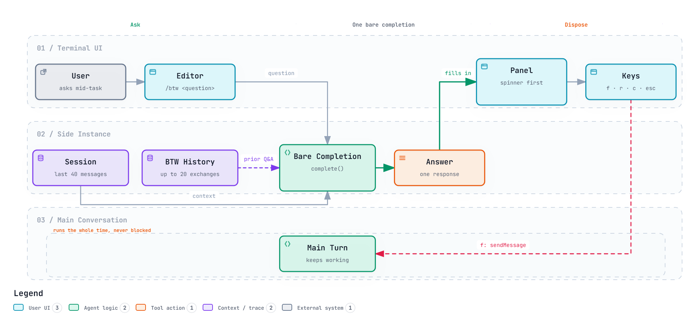

<div align="center">

# pi-btw

*Ask one question. Don't stop the work.*

[](LICENSE)
[](https://github.com/Finn763/pi-btw/stargazers)
[](https://github.com/earendil-works/pi-coding-agent)

[中文](README.zh-CN.md) | English

</div>

> A port of Claude Code's `/btw`, reverse-engineered from its shipped binary and rebuilt for Pi.

You are in the middle of a long task. A question pops up — "what does this function
actually do?" — and you have three bad options: interrupt the agent, start a new
session that knows nothing, or hold it in your head.

`/btw` is the fourth option: a side question that inherits the conversation, runs with
no tools, and finishes in one response while the main task keeps going.

```
/btw what does the retry wrapper in net.ts actually catch?
```

---

## Why pi-btw exists

Built to remove three failure modes of "just ask in the same window":

- **#1: Asking means interrupting.** The main task stops, your question becomes its
  new priority, and the thread you were on is gone. **Fix:** the side question runs on
  a separate instance with its own abort controller. The main loop never notices.
- **#2: A new window knows nothing.** A fresh session has no idea what "that retry
  wrapper" refers to, so you paste context and burn five minutes. **Fix:** the last 40
  messages of the session ride along, plus up to 20 earlier side questions.
- **#3: A side question that can act is not a side question.** If it can read files,
  run commands, or write back into the transcript, a "quick question" becomes a second
  agent fighting the first. **Fix:** `ctx.modelRegistry.complete()` is a bare
  completion. There is no tool loop to disable, no turn budget to enforce, and nothing
  written back to the session.

---

## How it runs


                      answer in a panel


1. **Ask** — `/btw <question>`. The panel opens immediately, spinner running, before
   the model has said anything.
2. **Answer** — one bare completion, session context prepended, system prompt that
   states plainly: no tools, one response, do not narrate actions.
3. **Read** — the answer lands in the panel. Long answers are capped at ~45% of the
   terminal and scroll; the conversation above stays visible.
4. **Decide** — keep it (`f`), follow up (`r`), copy it (`c`), or close (`esc`).

---

## The guarantee

No tool loop, because there is nothing to loop. The request carries no `tools` field
at all:

```ts
const response = await ctx.modelRegistry.complete(
    model,
    { system: SIDE_SYSTEM, messages },
    { cacheRetention: "short", sessionId: uuidv7() },
);
```

The system prompt backs it up with words the model cannot misread:

```
- You have NO tools available - you cannot read files, run commands, or search
- Do NOT write tool calls or tool output as text; nothing you write here is executed
- This is a one-off response - there are no follow-up turns
```

Verified end to end: the panel opens in under 2 s with `⠴ Answering…`; a 62-line
answer displays as a 19-line scrollable window instead of taking over the terminal.

---

## Proving `f` actually reaches the model

`f` sends the exchange into the main conversation with
`pi.sendMessage(..., { deliverAs: "steer", triggerTurn: false })` — it enters the
context without starting a turn. The test that shows it works:

```
/btw Remember the number 8317. Reply with just OK.
→ OK
[f]
What number did I ask you to remember? Reply with digits only.
→ 8317
```

`8317` exists nowhere except that side question. The main conversation answered it,
so the side question really did reach the context.

---

## Install

```bash
git clone https://github.com/Finn763/pi-btw.git
pi install ./pi-btw
```

Then `/reload` in a running session. Check with `pi list` — the path you cloned to
should appear there.

Requires Pi 1.5+ (`@earendil-works/pi-coding-agent`).

---

## Keys

```
/btw <question>   ask
/btw              reopen the most recent exchange
```

| key | action |
|---|---|
| `esc` / `enter` | close |
| `↑` `↓` | scroll a long answer (panel capped at ~45% of the screen) |
| `c` | copy the answer into the editor |
| `r` | reply — close and prefill `/btw ` for a follow-up |
| `f` | send this exchange into the main conversation |
| `←` `→` | browse earlier side questions |

---

## What pi-btw pins down

- **Context** — the last 40 messages of the session, plus up to 20 prior exchanges.
  Cap it deliberately: a huge session should not become a huge side query.
- **History** — memory only, 20 entries, gone when Pi exits. Same as Claude Code.
- **One answer** — never a second turn, never a tool call, never a transcript write.
- **No turn trigger** — `f` adds context, it does not make the agent speak.

---

## Where this came from

Claude Code ships `/btw` compiled into a Bun single-file binary. The implementation
here came from reading it: the side-question system prompt is verbatim, the
"one response, no tools" contract is the same, and so is the 20-entry history cap.

Two differences. Pi's `complete()` makes the no-tools guarantee structural instead of
defensive, so the four fallback layers Claude Code carries (`canUseTool` deny, tool_use
rewriting, XML-tool-call detection) are not needed here. And `f` sends the exchange
into the main conversation instead of forking a new branch, because that is what
people actually asked for.

---

## Contributing

Issues and PRs welcome. It is one file (`btw.ts`, ~330 lines) and no dependencies
beyond what Pi already ships.

## License

MIT
